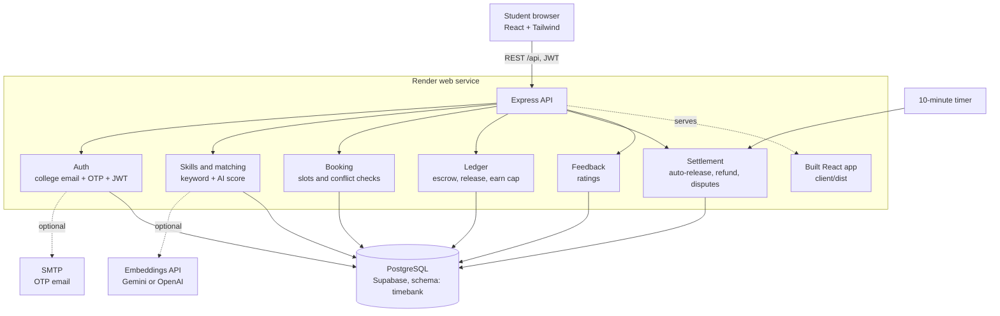
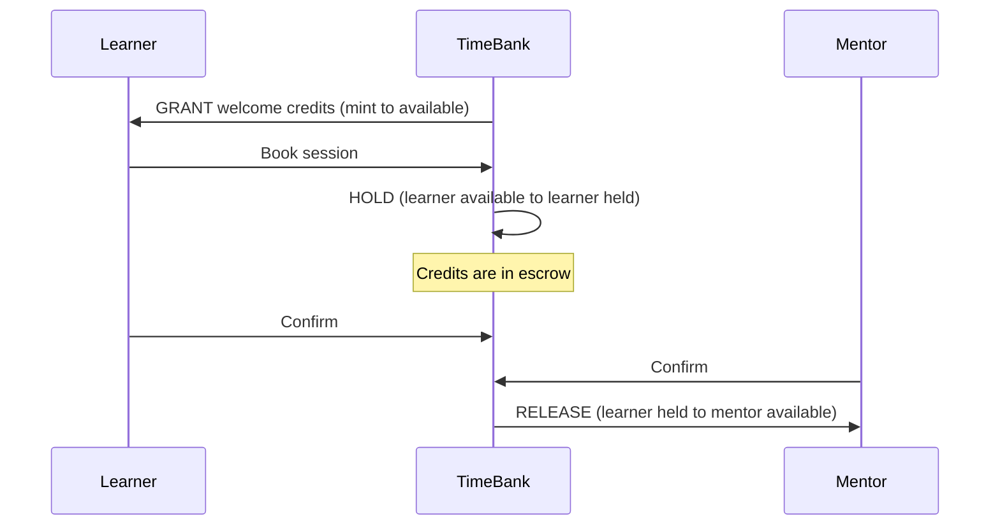
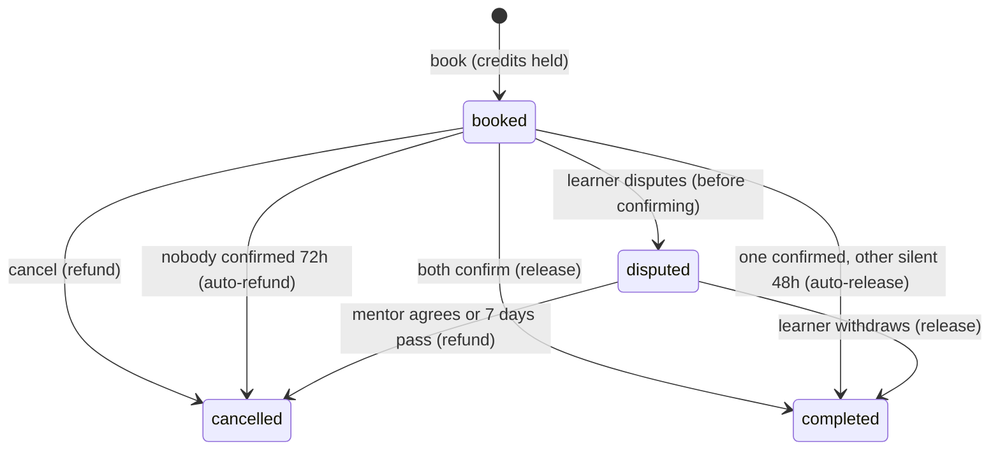
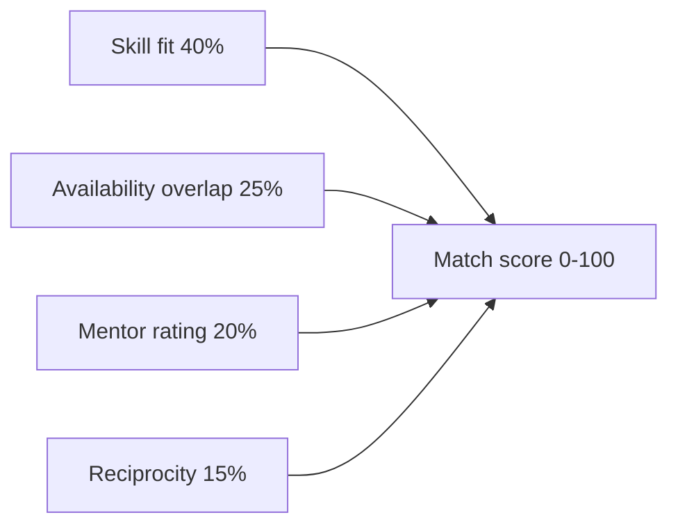
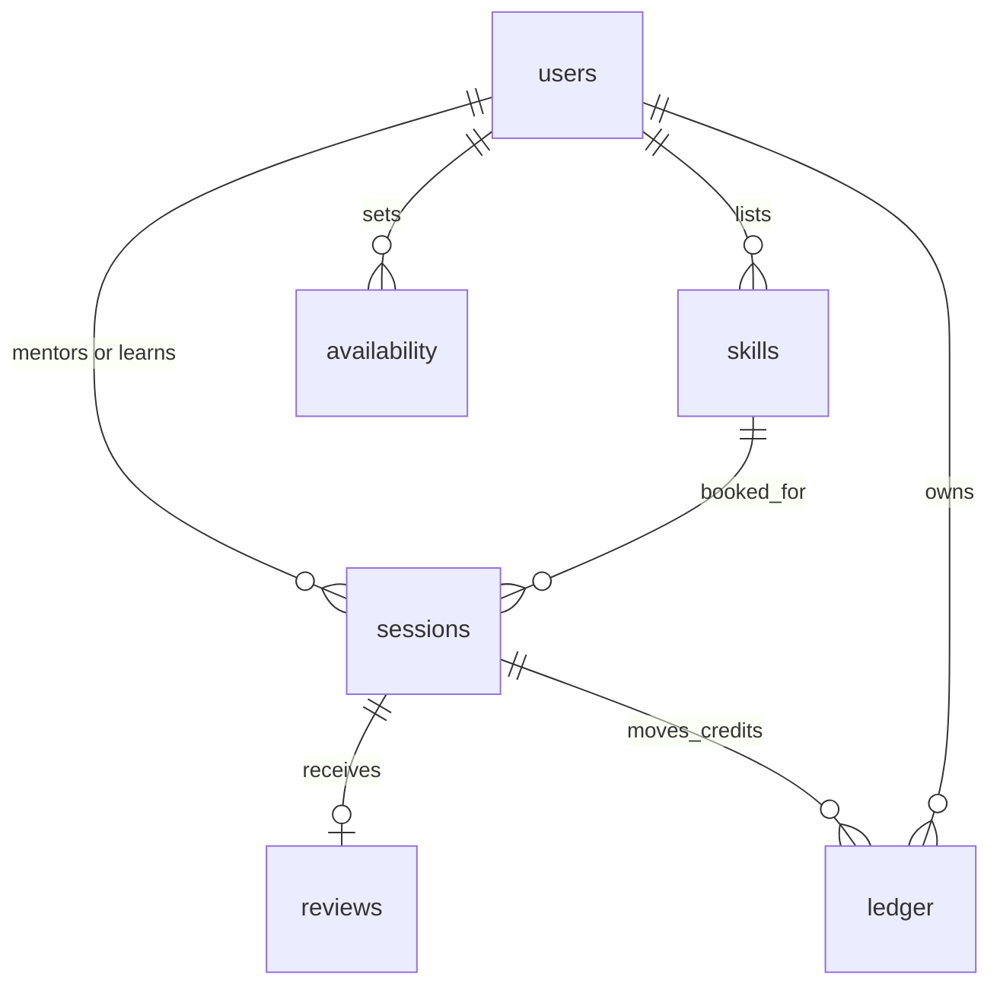

# TimeBank architecture

## System overview

Without `DATABASE_URL` the same code runs on embedded PGlite. Without `LLM_API_KEY` search falls back to keyword matching. Without SMTP the OTP is printed in the server log.

## Credit flow (double-entry ledger)

Every transaction sums to zero, and every ledger row stores the hash of the previous row. `GET /api/ledger/verify` recomputes the chain.

## Session lifecycle

## Match score

## Data model

